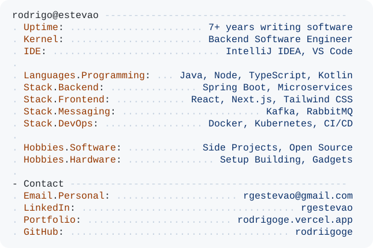

<picture>
  <source media="(prefers-color-scheme: dark)" srcset="./dark_mode.svg">
  
</picture>

---

### Welcome 👋

 I'm a backend software engineer with <b>7+ years of experience</b> developing and evolving software, primarily in the <b>financial services and payments</b> domain. I work with <b>Java, Kotlin, Spring Boot, microservices, REST APIs, and event-driven architectures</b>, with a focus on building systems that are reliable, maintainable, and ready to evolve. My experience includes architectural modernization, integrations, SQL and NoSQL databases, automated testing, and CI/CD. I value clear technical decisions, collaboration, and continuous learning—always aiming to solve the right problem, not just write more code. 

### What I work with

- **Backend:** Java, Kotlin, Spring Boot, REST APIs, Microservices
- **Frontend:** React, Next.js, Tailwind CSS
- **Architecture & Messaging:** Distributed Systems, Event-Driven Architecture, Kafka, RabbitMQ
- **Data & Delivery:** SQL, NoSQL, Docker, Kubernetes, CI/CD, Automated Testing
- **Engineering practices:** SOLID, Clean Code, Design Patterns

### Let's connect

I'm always happy to exchange ideas, share experiences, or talk about technology.

**[rgestevao@gmail.com](mailto:rgestevao@gmail.com)** · **[Portfolio](https://rodrigoge.vercel.app/)** · **[LinkedIn](https://www.linkedin.com/in/rgestevao/)**
